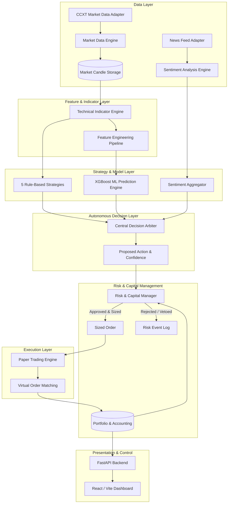

# CryptoPilot AI

[](https://github.com/your-username/cryptopilot-ai/actions)
[](https://www.python.org/downloads/)
[](https://opensource.org/licenses/MIT)
[](https://github.com/astral-sh/ruff)
[](https://mypy-lang.org/)
[](docs/TESTING.md)
[-brightgreen.svg)](ROADMAP.md)

**CryptoPilot AI** is a production-grade, modular, autonomous cryptocurrency spot trading agent engineered for mathematical discipline, zero-lookahead quantitative analysis, risk-first portfolio compounding, and transparent decision-making.

> [!IMPORTANT]
> **Paper Trading Only:** Operating exclusively in **PAPER TRADING** mode in its initial release, CryptoPilot AI provides realistic execution simulation across both a micro-capital portfolio ($30 initial capital, $10 monthly contributions) and an isolated quantitative research environment ($10,000 balance). Live trading execution is disabled at the architectural level.

---

## Table of Contents

- [Key Features](#key-features)
- [Architecture Overview](#architecture-overview)
- [Financial & Risk Rules](#financial--risk-rules)
- [Technology Stack](#technology-stack)
- [Project Structure](#project-structure)
- [Prerequisites](#prerequisites)
- [Installation Instructions](#installation-instructions)
- [Environment Configuration](#environment-configuration)
- [Running the Application](#running-the-application)
- [Running Tests & Quality Checks](#running-tests--quality-checks)
- [Security Mandate](#security-mandate)
- [Documentation Index](#documentation-index)
- [Development Roadmap & Status](#development-roadmap--status)

---

## Key Features

- **Public Market Data Ingestion:** Modular exchange abstraction built on CCXT. Ingests OHLCV, tickers, and order books for `BTC/USDT`, `ETH/USDT`, and `SOL/USDT` across `1m`, `15m`, `1h`, and `4h` timeframes without requiring private API keys.
- **Pure Indicator Calculation:** Zero-lookahead, mathematically verified implementations of SMA, EMA, RSI, MACD, Bollinger Bands, ATR, ADX, Stochastic, OBV, VWAP, Volatility, and Returns.
- **Multi-Strategy Ensemble:** 5 independent quantitative rule strategies (EMA Trend Following, RSI & MACD Momentum, Bollinger Mean Reversion, Volatility-Adjusted Momentum, and Multi-Timeframe Trend Confirmation).
- **Leak-Free Machine Learning:** Supervised XGBoost predictive pipeline evaluated using purged and embargoed chronological walk-forward splits.
- **Financial News Sentiment:** FinBERT-driven sentiment analysis featuring duplicate content detection (SHA-256), publication decay discounting, and conservative signal weighting.
- **Autonomous Decision Arbiter:** Transparent synthesis of technical signals, ML probabilities, sentiment scores, and market regime states, producing auditable `BUY`, `SELL`, or `HOLD` decisions with natural language rationales.
- **Strict Micro-Capital Risk Engine:** Position sizing dynamically pegged to:
  $$\text{Size} = \frac{\text{Risk Budget}}{\text{Stop Loss Distance} + \text{Estimated Fees}}$$
  - 1% equity risk budget per trade ($0.30 on $30 capital).
  - Maximum 30% single-position portfolio allocation ($9.00 on $30 capital).
  - Maximum 1 simultaneous active position.
  - 2% daily loss circuit breaker with immediate trading halt.
  - Monthly deposit ledgering separate from trading PnL.
  - Automatic compounding of eligible profits without revenge trading.
- **Realistic Paper Trading:** Event-driven virtual execution accounting for exchange maker/taker fees, bid/ask spreads, and order book slippage.
- **Full-Stack Observability:** FastAPI REST endpoints and an interactive React/TypeScript dashboard with clear visual separation between research and micro-capital simulations.

---

## Architecture Overview

CryptoPilot AI is architected as a modular monolith with strictly enforced separation of concerns:



For detailed component designs and data flows, see [docs/ARCHITECTURE.md](docs/ARCHITECTURE.md) and [docs/SYSTEM_DESIGN.md](docs/SYSTEM_DESIGN.md).

---

## Financial & Risk Rules

| Parameter | Small-Account Simulation | Research Lab Simulation |
|---|---|---|
| **Initial Capital** | $30.00 | $10,000.00 |
| **Monthly Contribution** | $10.00 / month (ledgered separately) | None |
| **Trading Market** | Cryptocurrency Spot only | Spot only |
| **Leverage** | None (1x) | None (1x) |
| **Max Concurrent Positions** | 1 position | Up to 3 positions |
| **Max Allocation / Position** | 30% of Portfolio Equity | 20% of Portfolio Equity |
| **Risk Budget / Trade** | 1.0% of Portfolio Equity | 1.0% of Portfolio Equity |
| **Daily Loss Circuit Breaker** | 2.0% of Starting Daily Equity | 2.0% of Starting Daily Equity |
| **Exchange Minimum Check** | Enforced (Trade skipped if violated) | Enforced |

---

## Technology Stack

| Component | Technology | Rationale |
|---|---|---|
| **Language** | Python 3.12+ (tested on Python 3.13) | Modern typing, performance, async IO support |
| **Market Data** | CCXT 4.5+ | Exchange-agnostic public data ingestion |
| **Validation** | Pydantic v2 & Pydantic-Settings | Strict schema validation, environment parsing |
| **Numerical Processing**| NumPy, Pandas | Fast vectorized array calculations |
| **Machine Learning** | Scikit-learn, XGBoost | Gradient boosted decision trees on tabular features |
| **Sentiment Analysis** | FinBERT / HuggingFace Transformers | Financial-specific sentiment classification |
| **Database & ORM** | PostgreSQL 16+ / SQLite (tests), SQLAlchemy 2.0, Alembic | Async relational persistence with migration tracking |
| **Backend API** | FastAPI, Uvicorn | High-throughput async REST endpoints |
| **Frontend UI** | React 18, TypeScript, Vite, Tailwind CSS | Responsive dashboard with research/trading separation |
| **Code Quality** | Pytest, Pytest-cov, Ruff, MyPy | 8-point testing standard, zero type errors |

---

## Project Structure

```
cryptopilot-ai/
├── README.md                      # Master project documentation
├── ROADMAP.md                     # 15-phase development roadmap and tracking
├── requirements.txt               # Pinned Python package dependencies
├── pyproject.toml                 # Packaging, build system, Ruff and MyPy configs
├── .env.example                   # Environment variable template
├── .gitignore                     # Git hygiene and secret prevention rules
│
├── docs/                          # In-depth architectural & technical documentation
│   ├── ARCHITECTURE.md            # System architecture and domain boundaries
│   ├── SYSTEM_DESIGN.md           # Concurrency model, interfaces, validation pipeline
│   ├── DATABASE_SCHEMA.md         # Relational database models and indexes
│   ├── API_DOCUMENTATION.md       # FastAPI REST endpoints and schemas
│   ├── TRADING_STRATEGY.md        # Rule-based quantitative strategies A through E
│   ├── RISK_MANAGEMENT.md         # Position sizing and circuit breakers
│   ├── BACKTESTING.md             # Event-driven backtester and walk-forward validation
│   ├── MACHINE_LEARNING.md        # XGBoost ML pipeline and anti-leakage invariants
│   ├── SENTIMENT_ANALYSIS.md      # News deduplication and FinBERT scoring
│   ├── PAPER_TRADING.md           # Virtual broker and simulated execution engine
│   ├── SECURITY.md                # Threat modeling and safety guarantees
│   ├── TESTING.md                 # 8-point method standard and test reports
│   ├── DEPLOYMENT.md              # Docker, compose, and disaster recovery
│   ├── DECISIONS.md               # Architecture Decision Records (ADRs)
│   └── CHANGELOG.md               # Version release notes and changes
│
├── src/
│   └── cryptopilot/
│       ├── __init__.py            # Root package
│       ├── config/                # Pydantic v2 application settings
│       ├── data/                  # CCXT exchange adapter, validation, and storage
│       ├── indicators/            # Pure mathematical technical indicators
│       ├── features/              # Feature engineering pipeline
│       ├── strategies/            # Independent quantitative rule strategies
│       ├── backtesting/           # Event-driven backtester engine
│       ├── models/                # Machine learning prediction pipeline
│       ├── sentiment/             # News ingestion and FinBERT analysis
│       ├── agent/                 # Central autonomous decision arbiter
│       ├── risk/                  # Risk budget and position sizing engine
│       ├── portfolio/             # Ledger and deposit tracking
│       ├── execution/             # Paper trading virtual broker
│       ├── exchange/              # Exchange precision and notional helpers
│       ├── database/              # SQLAlchemy models and migrations
│       ├── monitoring/            # Health, metrics, and telemetry
│       └── api/                   # FastAPI routes and schemas
│
├── tests/
│   ├── unit/                      # Isolated deterministic unit tests
│   ├── integration/               # Multi-component workflow tests
│   ├── backtesting/               # Backtesting scenario assertions
│   ├── security/                  # Security boundary assertions
│   └── fixtures/                  # Deterministic market data fixtures
│
├── data/
│   ├── historical/                # Ingested raw public market data
│   └── processed/                 # Validated, gap-free candle datasets
│
└── models/                        # Serialized ML model artifacts
```

---

## Prerequisites

- **Python:** Version 3.12 or 3.13 installed.
- **Git:** Version 2.30+ installed.
- **Node.js & npm:** (Optional, required for Phase 12 dashboard).
- **PostgreSQL:** (Optional, SQLite is used out-of-the-box for local testing).

---

## Installation Instructions

### 1. Clone the Repository
```bash
git clone https://github.com/your-username/cryptopilot-ai.git
cd cryptopilot-ai
```

### 2. Set Up Virtual Environment
```bash
python -m venv .venv

# On Windows (PowerShell):
.venv\Scripts\Activate.ps1

# On Linux/macOS:
source .venv/bin/activate
```

### 3. Install Python Dependencies
```bash
python -m pip install --upgrade pip
pip install -r requirements.txt
```

---

## Environment Configuration

Copy the example environment file and configure your local parameters:

```bash
cp .env.example .env
```

Key environment parameters:
```ini
# Application Mode
CRYPTOPILOT_ENV=development
LOG_LEVEL=INFO

# Trading Mode (Strictly PAPER in initial release)
TRADING_MODE=paper
ENABLE_LIVE_TRADING=false

# Account Environment (small_account or research)
ACCOUNT_TYPE=small_account
INITIAL_CAPITAL=30.0
MONTHLY_CONTRIBUTION=10.0

# Public Exchange Configuration
EXCHANGE_ID=binance
DEFAULT_SYMBOLS=BTC/USDT,ETH/USDT,SOL/USDT
DEFAULT_TIMEFRAMES=1m,15m,1h,4h

# Database Configuration (SQLite default for local development)
DATABASE_URL=sqlite+aiosqlite:///./data/cryptopilot_dev.db
```

---

## Running the Application

### Running Market Ingestion (Phase 1)
```bash
python -c "
import asyncio
from cryptopilot.data import ExchangeClient, CandleValidator, MarketDataStorage, Timeframe

async def main():
    async with ExchangeClient('binance') as client:
        ticker = await client.fetch_ticker('BTC/USDT')
        print(f'Current BTC/USDT Ticker: Bid={ticker.bid}, Ask={ticker.ask}, Last={ticker.last}')
        candles = await client.fetch_ohlcv('BTC/USDT', Timeframe.H1, limit=5)
        print(f'Fetched {len(candles)} candles. Validating...')
        res = CandleValidator.validate_series(candles, '1h')
        print(f'Validation Result: valid={res.is_valid}, candles={len(res.validated_candles)}')

asyncio.run(main())
"
```

---

## Running Tests & Quality Checks

Testing is mandatory for every component under the 8-point method testing standard.

```bash
# Run all unit and integration tests with coverage reporting
pytest --cov=cryptopilot --cov-report=term-missing

# Run Ruff linting check
ruff check src tests

# Run Ruff formatting check
ruff format --check src tests

# Run MyPy strict static type checks
mypy src
```

---

## Security Mandate

1. **Zero Real Money Risk:** Public exchange connectivity is strictly read-only.
2. **No Withdrawal Capabilities:** The architecture strictly prohibits withdrawal permissions or keys.
3. **Deterministic Failsafe:** Any data error, stale candle feed, or missing interval causes the decision engine to default to `HOLD`.
4. **Secret Isolation:** Environment secrets are never logged or committed to version control.

---

## Documentation Index

| Documentation File | Topic Covered |
|---|---|
| [ROADMAP.md](ROADMAP.md) | Master 15-Phase Development Plan and Progress Tracking |
| [docs/ARCHITECTURE.md](docs/ARCHITECTURE.md) | High-Level System Architecture and Design Principles |
| [docs/SYSTEM_DESIGN.md](docs/SYSTEM_DESIGN.md) | Concurrency Model, Component Interfaces, Failure Handling |
| [docs/DATABASE_SCHEMA.md](docs/DATABASE_SCHEMA.md) | PostgreSQL / SQLite Relational Schema & Table Specifications |
| [docs/API_DOCUMENTATION.md](docs/API_DOCUMENTATION.md) | FastAPI REST API Endpoints & Request/Response Contracts |
| [docs/TRADING_STRATEGY.md](docs/TRADING_STRATEGY.md) | Strategy Specifications (EMA, RSI/MACD, Bollinger, Momentum, MTF) |
| [docs/RISK_MANAGEMENT.md](docs/RISK_MANAGEMENT.md) | Mathematical Position Sizing and Circuit Breakers |
| [docs/BACKTESTING.md](docs/BACKTESTING.md) | Event-Driven Backtesting and Walk-Forward Validation |
| [docs/MACHINE_LEARNING.md](docs/MACHINE_LEARNING.md) | XGBoost ML Pipeline, Labeling, Anti-Leakage Invariants |
| [docs/SENTIMENT_ANALYSIS.md](docs/SENTIMENT_ANALYSIS.md) | FinBERT News Pipeline, Deduplication, Time-Decay |
| [docs/PAPER_TRADING.md](docs/PAPER_TRADING.md) | Virtual Execution Broker & Order Book Matching Simulation |
| [docs/SECURITY.md](docs/SECURITY.md) | Security Principles, Threat Modeling, Safe Shutdown |
| [docs/TESTING.md](docs/TESTING.md) | Testing Pyramid, 8-Point Method Standard, Verification Logs |
| [docs/DEPLOYMENT.md](docs/DEPLOYMENT.md) | Docker & Docker Compose Production Deployment Guide |
| [docs/DECISIONS.md](docs/DECISIONS.md) | Architecture Decision Records (ADR-001 through ADR-007) |
| [docs/CHANGELOG.md](docs/CHANGELOG.md) | Version Release Notes and Chronological Updates |

---

## Development Roadmap & Status

Current Status: **Phase 6: Sentiment Analysis Engine (Completed - 295 tests passing, 96% overall coverage, 92% sentiment coverage)**

Track detailed implementation progress and acceptance criteria across all 15 phases in [ROADMAP.md](ROADMAP.md).
See recent changes in [docs/CHANGELOG.md](docs/CHANGELOG.md).