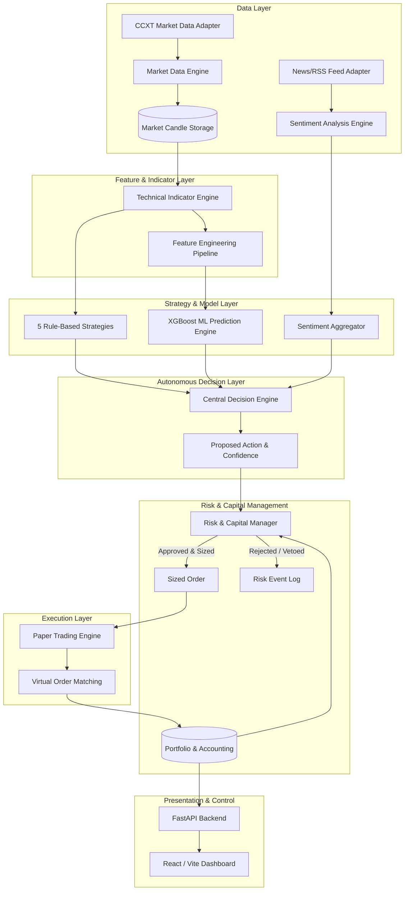
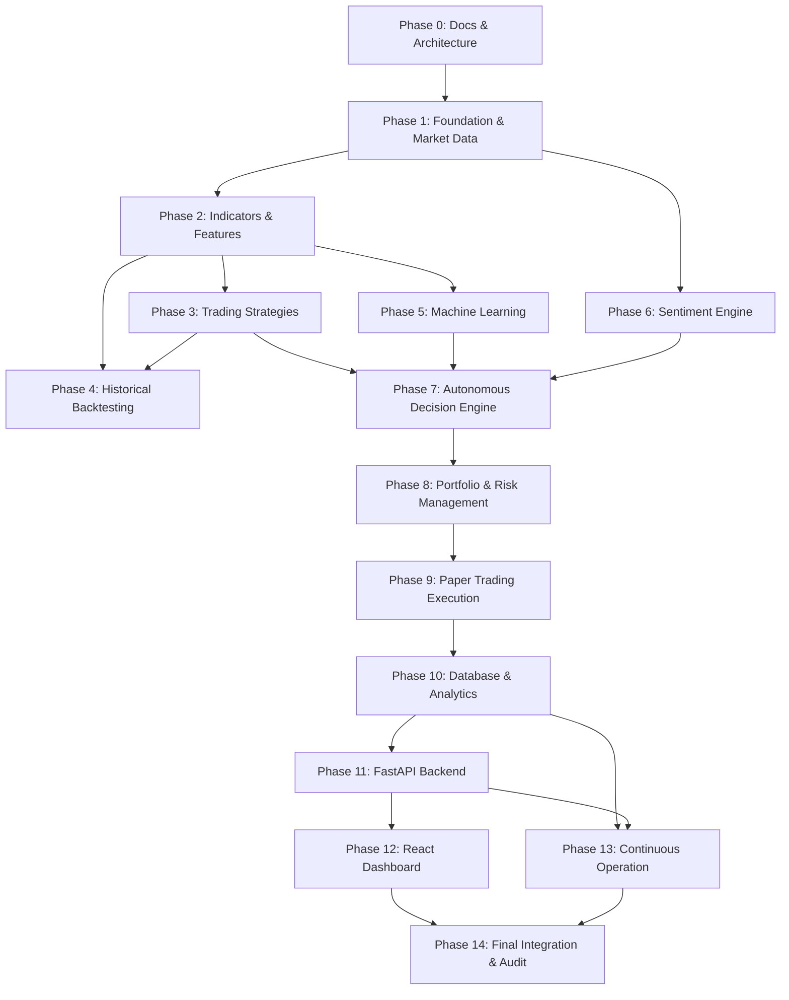

# CryptoPilot AI: Master Development Roadmap

## Project Overview
**CryptoPilot AI** is a production-grade, modular, autonomous cryptocurrency spot trading agent with an initial focus on automated paper trading, quantitative risk management, machine learning signal verification, and portfolio compounding.

Designed specifically to operate under strict quantitative constraints, including micro-capital accounts ($30 initial capital, $10 monthly contributions) as well as larger research simulations ($10,000 balance), CryptoPilot AI enforces strict capital preservation, transparent audit trails, and zero lookahead bias.

---

## 1. Project Objectives & Core Requirements

### 1.1 Functional Requirements
- **Market Data Engine:** Multi-exchange public data ingestion via CCXT with normalization, gap detection, retry backoff, and UTC timestamping (BTC/USDT, ETH/USDT, SOL/USDT across 1m, 15m, 1h, 4h).
- **Technical Indicator Engine:** Pure, deterministic, zero-lookahead calculations for SMA, EMA, RSI, MACD, Bollinger Bands, ATR, ADX, Stochastic, OBV, VWAP, Volatility, and Returns.
- **Trading Strategies:** Five discrete rule-based strategies generating granular signals (BUY, SELL, HOLD), confidence scores, and explicit rationale.
- **Backtesting Engine:** Event-driven historical backtester supporting realistic order execution, slippage, commission, partial fills, stop-loss/take-profit, and walk-forward validation.
- **Machine Learning Engine:** Supervised learning pipeline (XGBoost) predicting net-of-fee excess returns using chronological time-series cross-validation without leakage.
- **Sentiment Engine:** Financial news analysis via FinBERT/sentiment adapters with deduplication, publication time decay, and relevance scoring.
- **Autonomous Decision Engine:** Central arbiter combining technical signals, ML forecasts, sentiment indices, market regime classification, and strict risk vetoes.
- **Portfolio & Risk Management:** Mathematical position sizing based on `Risk Budget / (Stop Loss Distance + Est Fees)`, max 30% position allocation, 1% risk budget per trade, 2% daily loss limit, and dynamic compounding.
- **Paper Trading Engine:** Realistic virtual broker with order book simulation, limit/market order states, and full audit logging.
- **Data Persistence & Analytics:** Relational PostgreSQL/SQLite schemas via SQLAlchemy and Alembic tracking candles, signals, trades, portfolio transactions, and risk events.
- **FastAPI Backend & React Dashboard:** RESTful administrative/monitoring API and responsive UI providing clear visual separation between research mode and micro-capital trading.

### 1.2 Non-Functional Requirements
- **Correctness & Financial Realism:** Exact floating-point and decimal handling; explicit accounting for exchange minimums, fees, and slippage.
- **Reliability:** Graceful handling of network disconnects, API rate limits, exchange downtime, and corrupted data with default-to-HOLD fallbacks.
- **Security:** Strict separation of paper trading environments; absolute prohibition of exchange withdrawal permissions; zero credential logging; least-privilege configurations.
- **Testability & Quality:** Mandatory unit tests for every implemented method (testing valid, invalid, boundary, empty, missing, unexpected, error conditions, and precision); >90% coverage target; 100% risk/accounting coverage target.
- **Maintainability:** Modular monolith architecture, PEP 8 / Ruff compliance, strict type annotations (MyPy), comprehensive docstrings, and Architecture Decision Records (ADRs).

---

## 2. System Architecture & Boundaries

---

## 3. Technology Stack

| Layer | Component | Choice |
|---|---|---|
| **Runtime** | Programming Language | Python 3.12+ (tested on Python 3.13) |
| **Data Fetching** | Market Connectivity | CCXT (REST + Public endpoints, no keys required for data) |
| **Data Manipulation** | Numerical / DataFrames | Pandas, NumPy |
| **Indicators** | Technical Analysis | Custom zero-lookahead vector calculations (NumPy/Pandas) |
| **Machine Learning**| Predictive Modeling | Scikit-learn, XGBoost |
| **Sentiment** | NLP & Text Processing | FinBERT / HuggingFace Transformers / Configurable Adapters |
| **Database** | ORM & Relational Store | SQLAlchemy 2.0+, PostgreSQL (Production), SQLite (Unit testing) |
| **Migrations** | Schema Evolution | Alembic |
| **Backend API** | REST API & Validation | FastAPI, Pydantic v2, Uvicorn |
| **Frontend** | User Interface | React 18+, TypeScript, Vite, Lightweight Charts / Chart.js, TailwindCSS |
| **Testing** | Suite & Code Quality | Pytest, Pytest-cov, Pytest-asyncio, Hypothesis, Ruff, MyPy |
| **Containerization**| Deployment | Docker, Docker Compose |

---

## 4. Development Phases & Progress Tracking

### Phase 0: Requirements, Architecture & Documentation
- [x] **Phase 0.1**: Inspect workspace and runtime environment.
- [x] **Phase 0.2**: Create comprehensive `ROADMAP.md` covering all 15 phases.
- [x] **Phase 0.3**: Create comprehensive `README.md`.
- [x] **Phase 0.4**: Initialize all 15 documentation files in `docs/`.
- [x] **Phase 0.5**: Document system architecture, module boundaries, and testing strategy.
- [x] **Phase 0.6**: Present documentation foundation and Phase 1 implementation plan for review.
*Deliverables:* Master documentation suite, complete roadmap, architecture design records.

---

### Phase 1: Project Foundation & Market Data Collection
- [ ] **Phase 1.1**: Set up project packaging (`pyproject.toml`, requirements, Ruff, MyPy, pre-commit config).
- [ ] **Phase 1.2**: Implement core configuration management (`cryptopilot.config`) with Pydantic Settings.
- [ ] **Phase 1.3**: Implement base domain models and entities (Candle, Ticker, OrderBook, Symbol, Timeframe).
- [ ] **Phase 1.4**: Implement CCXT exchange adapter with rate-limiting, exponential backoff, and retry logic.
- [ ] **Phase 1.5**: Implement historical and real-time OHLCV data retrieval (BTC/USDT, ETH/USDT, SOL/USDT; 1m, 15m, 1h, 4h).
- [ ] **Phase 1.6**: Implement market metadata, precision, minimum notional, and bid/ask spread handlers.
- [ ] **Phase 1.7**: Implement candle validation, gap/missing candle detection, and duplicate detection.
- [ ] **Phase 1.8**: Implement unit and mock-based integration tests covering all methods and edge cases.
*Deliverables:* Working data ingestion engine, unit test suite with >90% coverage, verified offline data fixtures.

---

### Phase 2: Technical Indicator & Feature Engineering Engine
- [ ] **Phase 2.1**: Implement moving averages (SMA, EMA, Volume-weighted MA) with verified mathematical formulas.
- [ ] **Phase 2.2**: Implement momentum indicators (RSI, Stochastic Oscillator).
- [ ] **Phase 2.3**: Implement trend & volatility indicators (MACD, Bollinger Bands, ATR, ADX, Historical Volatility).
- [ ] **Phase 2.4**: Implement volume indicators (OBV, VWAP, Volume Spikes).
- [ ] **Phase 2.5**: Implement feature normalization and transformation pipelines (multi-period returns, log returns, volatility scaling).
- [ ] **Phase 2.6**: Build WarmupPeriod & Lookahead Bias assertion test suite comparing against independent reference values.
*Deliverables:* Modular indicator library with mathematical validation and zero-lookahead guarantees.

---

### Phase 3: Trading Strategy Development
- [ ] **Phase 3.1**: Strategy interface & signal schema (`BUY`, `SELL`, `HOLD`, confidence, rationale, invalidation).
- [ ] **Phase 3.2**: Strategy A: EMA Trend Following (fast/slow cross with trend confirmation).
- [ ] **Phase 3.3**: Strategy B: RSI & MACD Multi-Condition Momentum.
- [ ] **Phase 3.4**: Strategy C: Bollinger Band Volatility Mean Reversion.
- [ ] **Phase 3.5**: Strategy D: Volatility-Adjusted Momentum (ATR-scaled trend capture).
- [ ] **Phase 3.6**: Strategy E: Multi-Timeframe Trend Confirmation (1h macro regime + 15m entry).
- [ ] **Phase 3.7**: Unit tests for all strategy signal generations, edge cases, and confidence calculations.
*Deliverables:* Five battle-tested rule strategies with explicit rationales and edge-case validation.

---

### Phase 4: Historical Backtesting Engine
- [ ] **Phase 4.1**: Event-driven backtester core (TimeStep, EventQueue, DataHandler).
- [ ] **Phase 4.2**: Simulated order execution model with fees (maker/taker), spread, and variable slippage.
- [ ] **Phase 4.3**: Position tracking, equity curve accounting, and stop-loss/take-profit triggers.
- [ ] **Phase 4.4**: Performance analytics calculation (Net Return, CAGR, Win Rate, Profit Factor, Max Drawdown, Sharpe, Sortino).
- [ ] **Phase 4.5**: Benchmark comparisons (vs Buy & Hold BTC, ETH, and Cash).
- [ ] **Phase 4.6**: Walk-forward validation and out-of-sample partition tooling.
*Deliverables:* Complete backtesting harness with detailed equity curve analytics and benchmark reports.

---

### Phase 5: Machine Learning Prediction Engine
- [ ] **Phase 5.1**: ML target definition (e.g. Forward Return > Transaction Cost threshold).
- [ ] **Phase 5.2**: Time-series cross-validation splitters (Purged & Embargoed walk-forward split).
- [ ] **Phase 5.3**: Feature pipeline with strictly chronological fitting (StandardScaler/RobustScaler fitted on train only).
- [ ] **Phase 5.4**: XGBoost model training, hyperparameter configuration, and probability calibration.
- [ ] **Phase 5.5**: Feature importance evaluation (SHAP / gain-based) and baseline comparison.
- [ ] **Phase 5.6**: Model artifact versioning, serialization, and deterministic inference engine.
*Deliverables:* Production ML inference pipeline with time-series validation and zero data leakage.

---

### Phase 6: Sentiment Analysis Engine
- [ ] **Phase 6.1**: News and social feed abstraction adapter (RSS/CryptoPanic/Mocked News Provider).
- [ ] **Phase 6.2**: Deduplication engine using cryptographic content hashing and fuzzy title matching.
- [ ] **Phase 6.3**: FinBERT sentiment inference pipeline (Bullish, Bearish, Neutral with confidence scores).
- [ ] **Phase 6.4**: Publication timestamp handling and exponential time-decay weighting.
- [ ] **Phase 6.5**: Asset relevance tagging and sentiment aggregation index per symbol.
*Deliverables:* Robust sentiment pipeline with staleness pruning and conservative influence weighting.

---

### Phase 7: Autonomous Decision Engine
- [ ] **Phase 7.1**: Strict decision schema definition (`Symbol`, `Decision`, `Confidence`, `Signals`, `ML`, `Sentiment`, `Risk`, `Rationale`).
- [ ] **Phase 7.2**: Central Decision Arbiter combining technical, ML, and sentiment inputs.
- [ ] **Phase 7.3**: Market regime classifier (Trending Bull, Trending Bear, Ranging, High Volatility).
- [ ] **Phase 7.4**: Default-to-HOLD safety state on stale data, conflicting signals, or model degradation.
- [ ] **Phase 7.5**: Transparent explanation generator (interpretable rationale for every decision).
*Deliverables:* Deterministic decision arbitration module with complete decision traceability.

---

### Phase 8: Capital & Portfolio Risk Management
- [ ] **Phase 8.1**: Portfolio accounting (Cash, Invested Equity, Realized PnL, Unrealized PnL, Total Deposits).
- [ ] **Phase 8.2**: Monthly contribution ledger ($10/month separation from trading PnL).
- [ ] **Phase 8.3**: Position sizing algorithm: `Size = (Equity * RiskBudget) / (StopLossDist + EstFees)`.
- [ ] **Phase 8.4**: Capital constraint validation (Max 30% allocation, Max 1 position, Min notional checks).
- [ ] **Phase 8.5**: Risk controls: 2% daily loss circuit breaker, consecutive loss cooldown, emergency stop.
- [ ] **Phase 8.6**: Automatic profit compounding logic with dynamic equity recalculation.
*Deliverables:* Mathematical risk engine with 100% test coverage on critical accounting calculations.

---

### Phase 9: Paper Trading & Virtual Execution Engine
- [ ] **Phase 9.1**: Virtual wallet and balance ledger isolating research ($10,000) from micro-capital ($30).
- [ ] **Phase 9.2**: Simulated order lifecycle (PENDING, SUBMITTED, PARTIALLY_FILLED, FILLED, CANCELED, REJECTED).
- [ ] **Phase 9.3**: Realistic matching against public orderbook/ticker data including spread and slippage.
- [ ] **Phase 9.4**: Bracket order support (simulated simultaneous Stop-Loss and Take-Profit).
- [ ] **Phase 9.5**: Audit logging of all order submissions, fills, and ledger balance adjustments.
*Deliverables:* Self-contained paper trading engine with zero live-exchange order capabilities.

---

### Phase 10: Database Schema & Performance Analytics
- [ ] **Phase 10.1**: SQLAlchemy 2.0 async/sync models for all entities (Candles, Orders, Positions, Trades, RiskEvents, etc.).
- [ ] **Phase 10.2**: Alembic migrations setup and initial migration scripts.
- [ ] **Phase 10.3**: Atomic database transaction management for balance updates and trade fills.
- [ ] **Phase 10.4**: Database query repositories with optimized indexing on UTC timestamps and symbols.
- [ ] **Phase 10.5**: Performance metrics computation services (Sharpe, Drawdown, Profit Factor over rolling windows).
*Deliverables:* Normalized, indexed relational persistence layer with automated migrations and rollback support.

---

### Phase 11: FastAPI Backend
- [ ] **Phase 11.1**: Application factory, middleware (CORS, error handling, request logging).
- [ ] **Phase 11.2**: Health check and system diagnostic endpoints (`/api/v1/health`, `/api/v1/status`).
- [ ] **Phase 11.3**: Market data and ticker endpoints (`/api/v1/market/...`).
- [ ] **Phase 11.4**: Portfolio, balance, and position endpoints (`/api/v1/portfolio/...`).
- [ ] **Phase 11.5**: Order and trade history endpoints (`/api/v1/orders/...`, `/api/v1/trades/...`).
- [ ] **Phase 11.6**: Decision explanation and risk monitoring endpoints (`/api/v1/decisions/...`, `/api/v1/risk/...`).
- [ ] **Phase 11.7**: Paper trading controls and simulated deposit injection (`/api/v1/control/...`).
*Deliverables:* Fully documented, typed REST API with OpenAPI/Swagger integration.

---

### Phase 12: React Dashboard
- [ ] **Phase 12.1**: Vite + React + TypeScript application initialization with Tailwind CSS.
- [ ] **Phase 12.2**: Portfolio summary header (Balance, Equity, Deposits, Realized/Unrealized PnL, Drawdown).
- [ ] **Phase 12.3**: Interactive price and equity curve charting (Candlestick + Trade Markers).
- [ ] **Phase 12.4**: Live strategy signals, ML predictions, and sentiment breakdown panels.
- [ ] **Phase 12.5**: Decision transparency card with AI explanation logs.
- [ ] **Phase 12.6**: Active positions, open orders, and historical trade audit tables.
- [ ] **Phase 12.7**: Visual toggle & warning badge strictly separating Research ($10,000) from Small-Account ($30).
*Deliverables:* Modern, reactive dashboard providing complete visibility into agent decisions and performance.

---

### Phase 13: Continuous Operation, Monitoring & Deployment
- [ ] **Phase 13.1**: Autonomous loop orchestration (async scheduler, candle tick event loop).
- [ ] **Phase 13.2**: Health monitoring, heartbeat telemetry, and log rotation.
- [ ] **Phase 13.3**: Automated notification adapter (console, webhook, email alerts on trades or halts).
- [ ] **Phase 13.4**: Production Dockerfile and multi-service `docker-compose.yml` (App + PostgreSQL).
*Deliverables:* Production containerization and continuous daemon execution pipeline.

---

### Phase 14: Final Integration, Security Review & Validation
- [ ] **Phase 14.1**: End-to-end integration testing (Data -> Feature -> Strategy -> Decision -> Risk -> Paper Trade).
- [ ] **Phase 14.2**: Security audit: verify absence of withdrawal keys, zero credential leakage in logs, input sanitization.
- [ ] **Phase 14.3**: Edge case stress testing (simulated market crash, network loss, gap down through stop-loss).
- [ ] **Phase 14.4**: Verification of final test coverage (>90% global, 100% risk/accounting).
- [ ] **Phase 14.5**: Documentation freeze and final production readiness sign-off.
*Deliverables:* Fully validated, secure, autonomous paper-trading platform ready for long-duration operation.

---

## 5. Phase Dependency Graph

---

## 6. Known Risks & Mitigation Strategies

1. **Micro-Capital Constraints ($30 Capital):**
   - *Risk:* Exchange minimum notional (often $5 or $10 on Binance/Coinbase) may exceed a conservative 1% risk budget.
   - *Mitigation:* The risk manager strictly verifies minimum order notional. If a trade cannot be sized safely within the 30% max allocation and risk parameters, the trade is explicitly skipped with a logged reason.
2. **Overfitting & Lookahead Bias in ML:**
   - *Risk:* Machine learning models learn spurious future patterns.
   - *Mitigation:* Strict chronological walk-forward splits, feature scaling fit strictly on train sets, and purged/embargoed cross-validation.
3. **Execution Assumptions in Paper Trading:**
   - *Risk:* Assuming simulated orders fill instantly at exact market prices without slippage.
   - *Mitigation:* Explicit modeling of bid/ask spread, volume-weighted average price (VWAP) impact, and maker/taker commission deductions.
4. **Exchange Disconnects & Stale Data:**
   - *Risk:* Acting on outdated prices during network outages.
   - *Mitigation:* Strict candle age verification (rejecting candles older than timeframe duration + tolerance) with automatic fallback to `HOLD`.

