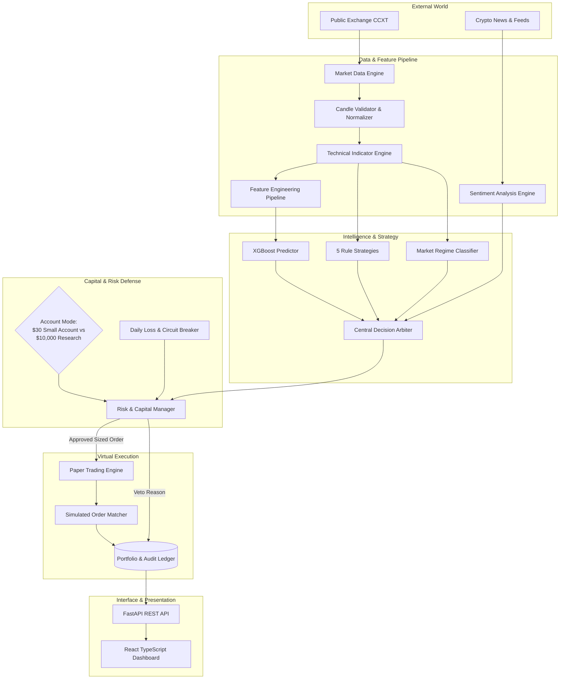
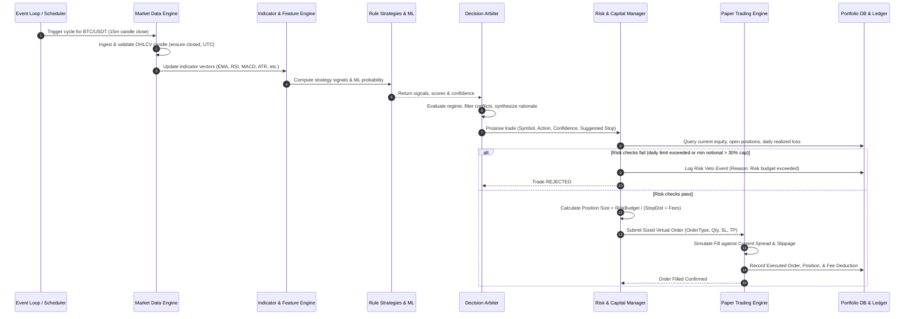
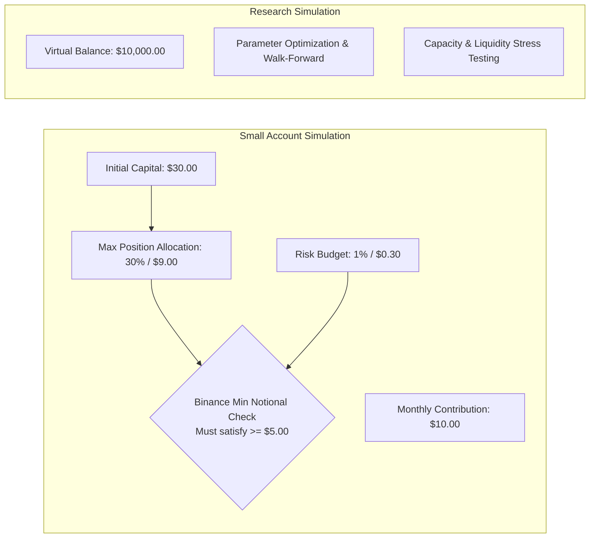

# CryptoPilot AI: Architecture Document

## 1. Architectural Principles & Philosophy

CryptoPilot AI is engineered around six fundamental quantitative software engineering principles:

1. **Capital Preservation Above All (Risk Asymmetry):** In trading, preventing catastrophic drawdown is infinitely more critical than catching every rally. The system prioritizes risk vetoes over any strategy signal or ML prediction.
2. **Deterministic, Zero-Lookahead Computations:** Every indicator, feature, strategy signal, and ML input must only use data available strictly at or before the timestamp of observation. No forward-peeking, future centering, or post-hoc data leaks are permitted.
3. **Rigid Separation of Environments:** The $30 micro-capital paper trading account and the $10,000 research backtesting/simulation environment must exist in strictly isolated domains. Balances, performance metrics, and ledgers never cross-pollinate.
4. **Autonomous Transparency (Explainability):** No "black-box" decisions. Every `BUY`, `SELL`, or `HOLD` action must generate a structured JSON payload containing the exact indicators, ML confidence, sentiment score, and explicit natural language rationale behind the trade.
5. **Fail-Safe Defaults (Default to HOLD):** In the event of network disruption, rate limits, missing candles, ML model uncertainty, or conflicting indicator signals, the system always reverts to a `HOLD` state.
6. **Modular Monolith Architecture:** Avoid premature distributed systems complexity. The application is built with clean interface boundaries in a single repository, allowing painless refactoring, rapid unit testing, and straightforward containerization.

---

## 2. High-Level System Architecture

---

## 3. Module Boundaries & Responsibilities

| Module | Location | Primary Responsibility | Strict Boundaries |
|---|---|---|---|
| **Config** | `cryptopilot.config` | Pydantic-based settings, environment validation. | Reads environment; does not execute logic. |
| **Data Engine** | `cryptopilot.data` | Fetches OHLCV, tickers, order books via CCXT. Validates gaps, timestamps, deduplication. | Only reads public data; never interacts with user funds. |
| **Indicator Engine**| `cryptopilot.indicators` | Calculates pure mathematical technical indicators (SMA, EMA, RSI, MACD, etc.). | Stateless functions; no IO or exchange calls. |
| **Feature Engine** | `cryptopilot.features` | Assembles lag features, multi-timeframe returns, and volatility inputs for ML. | Strict chronological computation; no future leaks. |
| **Strategies** | `cryptopilot.strategies` | Five independent quantitative rule engines generating BUY/SELL/HOLD and confidence. | Independent from ML and Sentiment; evaluates pure indicator state. |
| **ML Engine** | `cryptopilot.models` | XGBoost training, probability calibration, and forward return inference. | Model cannot place orders; outputs probability distribution only. |
| **Sentiment Engine**| `cryptopilot.sentiment` | News aggregation, deduplication, FinBERT sentiment scoring, and time-decay weighting. | Supplementary weight only; cannot override negative technicals/risk. |
| **Decision Arbiter**| `cryptopilot.agent` | Aggregates all upstream signals, applies regime filters, generates explicit rationales. | Passes raw recommendation to Risk Manager; cannot execute trades directly. |
| **Risk Manager** | `cryptopilot.risk` | Sizes positions using stop loss distance, enforces 1% risk budget, 30% max allocation, 2% daily loss cap. | Ultimate gatekeeper; possesses veto power over all orders. |
| **Portfolio Ledger**| `cryptopilot.portfolio`| Tracks virtual cash, realized/unrealized PnL, deposits ($10/mo), and dynamic compounding equity. | Strict separation of trading profits from external contributions. |
| **Paper Execution**| `cryptopilot.execution`| Virtual broker simulating order lifecycle, slippage, bid/ask spread, and exchange commission. | Zero real exchange order routing. Simulates fills via public data. |
| **Database** | `cryptopilot.database` | Relational persistence (PostgreSQL/SQLite) with SQLAlchemy 2.0 and Alembic. | Isolated database transactions with audit logging. |
| **FastAPI REST** | `cryptopilot.api` | Exposes REST endpoints for monitoring, telemetry, and backtesting triggers. | Validates all inputs using Pydantic; never exposes secrets. |
| **React Dashboard** | `frontend/` | Web UI visualizing equity curves, open positions, signals, and explainability cards. | Presentation only; communicates strictly via REST API. |

---

## 4. End-to-End Execution Sequence

---

## 5. Architectural Separation: Research vs. Small Account

To guarantee financial integrity and avoid unrealistic expectations:

- **Small-Account Simulation ($30 initial):** Directly models the realities of micro-capital spot trading. When the 30% maximum allocation constraint ($9.00 on a $30 balance) collides with exchange minimum notional requirements (e.g., Binance $5.00 or $10.00 min notional), the engine rigorously verifies that the minimum is satisfied without exceeding the allocation cap. If mathematically impossible to satisfy both, the trade is rejected.
- **Research Simulation ($10,000 virtual):** Serves for statistical strategy validation, parameter sweep robustness, and benchmark comparisons (vs Buy-and-Hold BTC/ETH) without micro-lot quantization distortions.

---

## 6. Zero-Lookahead and Anti-Leakage Invariants

1. **Closed Candles Only:** Signal generation strictly executes on `is_closed == True` candles. Incomplete current candles are never used for strategy triggers.
2. **Feature Alignment:** For candle at timestamp $T$, features are computed strictly using data from $\le T$.
3. **ML Time-Series Validation:** No K-Fold random shuffling. Only walk-forward cross-validation with purge periods (discarding samples where prediction horizon overlaps) and embargo periods (discarding samples immediately following train set to remove auto-correlation).
4. **StandardScaler / Transformers:** Scaling parameters (mean, standard deviation) are fitted exclusively on training splits and applied out-of-sample to validation and test splits.
