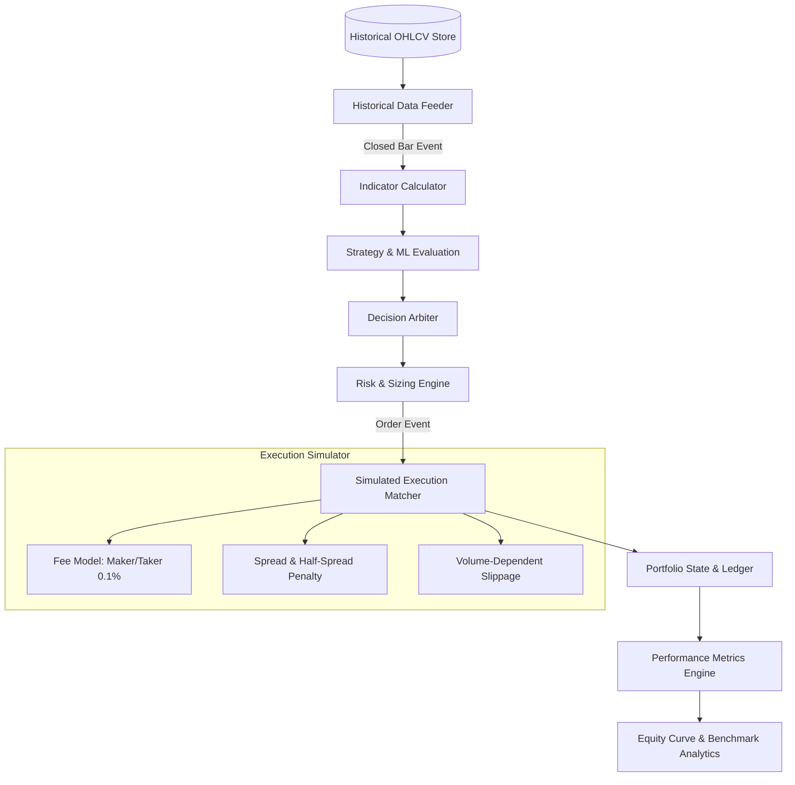
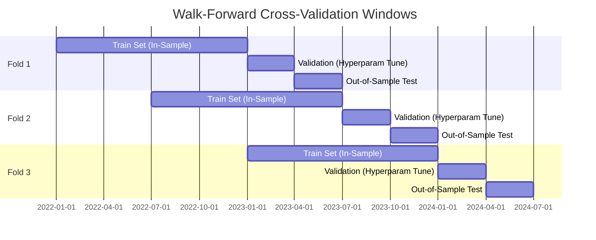

# CryptoPilot AI: Historical Backtesting Engine

## 1. Backtester Architecture

CryptoPilot AI includes an event-driven, bar-by-bar backtesting engine that simulates realistic trade execution, liquidity constraints, transaction fees, and bid/ask spreads.

---

## 2. Realistic Execution Modeling

### 2.1 Slippage & Spread Simulation
To prevent the common pitfall of unrealistically optimistic backtest fills, fills are modeled with:
- **Spread Penalty:** Orders execute at $Ask = Mid + \frac{Spread}{2}$ for BUYs, and $Bid = Mid - \frac{Spread}{2}$ for SELLs.
- **Slippage Model:**
  $$\text{Slippage} = \text{BaseSlippage} + \gamma \times \left(\frac{\text{OrderVolume}}{\text{BarVolume}}\right)^2$$
- **Bar Boundary Fills:** Market orders triggered at the close of Bar $T$ fill at the Open of Bar $T+1$ plus slippage and half-spread. High/Low boundary checks enforce whether a Stop-Loss or Take-Profit could have been executed within the bar.

### 2.2 Transaction Fee Model
- Default spot trading commission: $0.10\%$ ($10$ bps) per fill.
- Exact fee deduction recorded in quote asset.

---

## 3. Data Partitions & Walk-Forward Validation

To prevent overfitting and parameter snooping:

1. **In-Sample (Train):** Used exclusively for strategy parameter discovery and ML model fitting.
2. **Validation:** Used for hyperparameter tuning and threshold selection.
3. **Out-of-Sample (Test):** Held out until final evaluation. Parameters are **never** re-tuned on the final test set.

---

## 4. Performance Analytics & Key Metrics

Every backtest produces a comprehensive quantitative performance report including:

| Metric | Formula / Definition | Target Benchmark |
|---|---|---|
| **Net Return (%)** | $\frac{E_{final} - E_{initial}}{E_{initial}} \times 100$ | Exceed cash / risk-free |
| **CAGR (%)** | $\left(\frac{E_{final}}{E_{initial}}\right)^{\frac{1}{\text{Years}}} - 1$ | Annualized geometric growth |
| **Win Rate (%)** | $\frac{\text{Winning Trades}}{\text{Total Trades}} \times 100$ | Strategy-dependent ($>45\%$ for trend) |
| **Profit Factor** | $\frac{\sum \text{Gross Profits}}{\sum \text{Gross Losses}}$ | $> 1.50$ |
| **Maximum Drawdown (%)** | $\max_{\tau \in [0, t]} \left( \frac{\text{Peak}_\tau - E_t}{\text{Peak}_\tau} \right) \times 100$ | $< 15.0\%$ |
| **Sharpe Ratio** | $\frac{\mathbb{E}[R_p - R_f]}{\sigma(R_p)} \times \sqrt{365}$ | $> 1.50$ |
| **Sortino Ratio** | $\frac{\mathbb{E}[R_p - R_f]}{\sigma_{\text{downside}}(R_p)} \times \sqrt{365}$ | $> 2.00$ |
| **Expectancy ($)** | $(\text{Win Rate} \times \text{Avg Win}) - (\text{Loss Rate} \times \text{Avg Loss})$ | Positive net of fees |
| **Avg Holding Period** | $\frac{1}{N} \sum (\text{ExitTime} - \text{EntryTime})$ | Track trade turnover |
| **Total Fees Paid** | $\sum \text{OrderCommissions}$ | Measure broker drag |

### Benchmark Comparisons
Every run generates a comparative plot and table against:
- **Buy-and-Hold BTC**
- **Buy-and-Hold ETH**
- **Cash (0% return baseline)**
