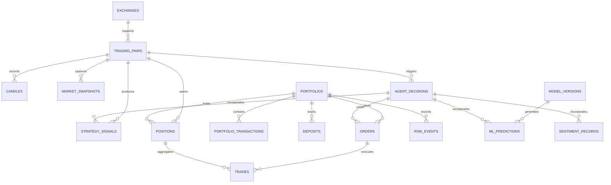

# CryptoPilot AI: Database Schema & Storage Architecture

## 1. Storage Architecture Overview

CryptoPilot AI employs an asynchronous relational database architecture powered by **SQLAlchemy 2.0 (AsyncIO)** and **Alembic** migrations.
- **Production Environment:** PostgreSQL 15+ (enforcing ACID compliance, row-level locking for order transactions, and partition-ready time-series storage).
- **Unit & Integration Testing:** In-memory or file-backed SQLite (`sqlite+aiosqlite`) ensuring rapid, fully isolated test suites without external database dependencies.

All timestamps are stored in strict **UTC** format (`TIMESTAMP WITH TIME ZONE`).

---

## 2. Entity-Relationship Diagram

---

## 3. Relational Tables Specification

### 3.1 Market Data Entities

#### `exchanges`
Stores supported exchange connection profiles.
- `id` (VARCHAR(32), Primary Key) — e.g., `'binance'`, `'coinbase'`.
- `name` (VARCHAR(64), Not Null).
- `is_active` (BOOLEAN, Default True).
- `rate_limit_ms` (INTEGER, Default 50).
- `created_at` (TIMESTAMP WITH TIME ZONE, UTC).

#### `trading_pairs`
Trading pair definitions, precision, and trading rules.
- `id` (INTEGER, Primary Key, Autoincrement).
- `exchange_id` (VARCHAR(32), Foreign Key -> `exchanges.id`).
- `symbol` (VARCHAR(20), Not Null) — e.g., `'BTC/USDT'`.
- `base_asset` (VARCHAR(10), Not Null) — e.g., `'BTC'`.
- `quote_asset` (VARCHAR(10), Not Null) — e.g., `'USDT'`.
- `price_precision` (INTEGER, Not Null) — decimal places for price.
- `quantity_precision` (INTEGER, Not Null) — decimal places for quantity.
- `min_quantity` (DECIMAL(20, 8), Not Null) — minimum order quantity.
- `min_notional` (DECIMAL(20, 8), Not Null) — minimum total order cost (e.g., $5.00).
- `is_active` (BOOLEAN, Default True).
- **Unique Constraint:** `(exchange_id, symbol)`.

#### `market_candles`
Historical and live normalized OHLCV candle observations.
- `id` (BIGINT, Primary Key, Autoincrement).
- `pair_id` (INTEGER, Foreign Key -> `trading_pairs.id`, Not Null).
- `timeframe` (VARCHAR(10), Not Null) — `'1m'`, `'15m'`, `'1h'`, `'4h'`.
- `open_time` (TIMESTAMP WITH TIME ZONE, Not Null).
- `close_time` (TIMESTAMP WITH TIME ZONE, Not Null).
- `open` (DECIMAL(24, 8), Not Null).
- `high` (DECIMAL(24, 8), Not Null).
- `low` (DECIMAL(24, 8), Not Null).
- `close` (DECIMAL(24, 8), Not Null).
- `volume` (DECIMAL(28, 8), Not Null).
- `is_closed` (BOOLEAN, Not Null, Default True).
- **Unique Index:** `(pair_id, timeframe, open_time)`.
- **Index:** `(open_time DESC)`.

#### `market_snapshots`
High-frequency order book and ticker snapshots.
- `id` (BIGINT, Primary Key, Autoincrement).
- `pair_id` (INTEGER, Foreign Key -> `trading_pairs.id`, Not Null).
- `timestamp` (TIMESTAMP WITH TIME ZONE, Not Null).
- `bid_price` (DECIMAL(24, 8), Not Null).
- `ask_price` (DECIMAL(24, 8), Not Null).
- `spread` (DECIMAL(24, 8), Not Null).
- `mid_price` (DECIMAL(24, 8), Not Null).

---

### 3.2 Strategy, ML & Sentiment Entities

#### `model_versions`
Registry of trained machine learning model artifacts.
- `id` (VARCHAR(64), Primary Key) — e.g., `'xgb_btc_1h_v1.0.0'`.
- `algorithm` (VARCHAR(32), Not Null) — e.g., `'XGBoostClassifier'`.
- `feature_set_version` (VARCHAR(32), Not Null).
- `train_start_date` (TIMESTAMP WITH TIME ZONE, Not Null).
- `train_end_date` (TIMESTAMP WITH TIME ZONE, Not Null).
- `metrics_json` (JSONB, Not Null) — validation accuracy, F1, Sharpe, log_loss.
- `artifact_path` (VARCHAR(256), Not Null).
- `created_at` (TIMESTAMP WITH TIME ZONE, UTC).

#### `strategy_signals`
Discrete signals emitted by rule-based strategy algorithms.
- `id` (BIGINT, Primary Key, Autoincrement).
- `pair_id` (INTEGER, Foreign Key -> `trading_pairs.id`, Not Null).
- `strategy_id` (VARCHAR(64), Not Null) — e.g., `'ema_trend'`, `'rsi_macd'`.
- `timeframe` (VARCHAR(10), Not Null).
- `signal` (VARCHAR(10), Not Null) — `'BUY'`, `'SELL'`, `'HOLD'`.
- `confidence` (DECIMAL(5, 4), Not Null) — range [0.0000, 1.0000].
- `entry_price` (DECIMAL(24, 8), Not Null).
- `suggested_stop_loss` (DECIMAL(24, 8), Not Null).
- `suggested_take_profit` (DECIMAL(24, 8), Nullable).
- `rationale` (TEXT, Not Null).
- `timestamp` (TIMESTAMP WITH TIME ZONE, Not Null).
- **Index:** `(pair_id, strategy_id, timestamp DESC)`.

#### `ml_predictions`
Outputs generated by ML models.
- `id` (BIGINT, Primary Key, Autoincrement).
- `pair_id` (INTEGER, Foreign Key -> `trading_pairs.id`, Not Null).
- `model_version_id` (VARCHAR(64), Foreign Key -> `model_versions.id`, Not Null).
- `timestamp` (TIMESTAMP WITH TIME ZONE, Not Null).
- `target_horizon` (VARCHAR(10), Not Null) — e.g., `'4h'`.
- `prediction_label` (INTEGER, Not Null) — e.g., 1 (Bullish), 0 (Bearish/Neutral).
- `probability` (DECIMAL(5, 4), Not Null).
- `feature_contributions_json` (JSONB, Nullable).

#### `sentiment_records`
News sentiment scores from FinBERT.
- `id` (BIGINT, Primary Key, Autoincrement).
- `source` (VARCHAR(64), Not Null).
- `headline` (VARCHAR(512), Not Null).
- `content_hash` (VARCHAR(64), Unique, Not Null) — SHA-256 for deduplication.
- `published_at` (TIMESTAMP WITH TIME ZONE, Not Null).
- `symbol_relevance` (VARCHAR(20), Not Null) — e.g., `'BTC/USDT'`.
- `sentiment_label` (VARCHAR(16), Not Null) — `'POSITIVE'`, `'NEGATIVE'`, `'NEUTRAL'`.
- `sentiment_score` (DECIMAL(5, 4), Not Null) — [-1.0, 1.0].
- `decayed_score` (DECIMAL(5, 4), Not Null).

#### `agent_decisions`
Unified audit log of the Central Autonomous Decision Arbiter.
- `id` (VARCHAR(64), Primary Key) — UUIDv4.
- `pair_id` (INTEGER, Foreign Key -> `trading_pairs.id`, Not Null).
- `timestamp` (TIMESTAMP WITH TIME ZONE, Not Null).
- `decision` (VARCHAR(10), Not Null) — `'BUY'`, `'SELL'`, `'HOLD'`.
- `confidence` (DECIMAL(5, 4), Not Null).
- `market_regime` (VARCHAR(32), Not Null).
- `strategy_signals_json` (JSONB, Not Null).
- `ml_prediction_json` (JSONB, Nullable).
- `sentiment_summary_json` (JSONB, Nullable).
- `risk_approved` (BOOLEAN, Not Null).
- `rejection_reason` (VARCHAR(128), Nullable).
- `explanation_text` (TEXT, Not Null).
- **Index:** `(timestamp DESC)`.

---

### 3.3 Portfolio, Accounting & Paper Execution Entities

#### `portfolios`
Main portfolio ledger accounts.
- `id` (VARCHAR(32), Primary Key) — e.g., `'small_account_01'`, `'research_lab_01'`.
- `account_type` (VARCHAR(32), Not Null) — `'small_account'` or `'research'`.
- `currency` (VARCHAR(10), Not Null, Default `'USDT'`).
- `initial_balance` (DECIMAL(24, 8), Not Null) — $30.00 or $10,000.00.
- `current_cash` (DECIMAL(24, 8), Not Null).
- `invested_capital` (DECIMAL(24, 8), Not Null, Default 0.0).
- `realized_pnl` (DECIMAL(24, 8), Not Null, Default 0.0).
- `total_deposits` (DECIMAL(24, 8), Not Null, Default 0.0).
- `total_fees_paid` (DECIMAL(24, 8), Not Null, Default 0.0).
- `is_trading_halted` (BOOLEAN, Not Null, Default False).
- `updated_at` (TIMESTAMP WITH TIME ZONE, UTC).

#### `deposits`
External capital contributions tracked distinctly from trading profits.
- `id` (BIGINT, Primary Key, Autoincrement).
- `portfolio_id` (VARCHAR(32), Foreign Key -> `portfolios.id`, Not Null).
- `amount` (DECIMAL(24, 8), Not Null) — e.g., $10.00.
- `currency` (VARCHAR(10), Not Null, Default `'USDT'`).
- `timestamp` (TIMESTAMP WITH TIME ZONE, Not Null).
- `note` (VARCHAR(256), Nullable) — e.g., `'Monthly recurring contribution'`.

#### `positions`
Active and closed trading positions.
- `id` (VARCHAR(64), Primary Key) — UUIDv4.
- `portfolio_id` (VARCHAR(32), Foreign Key -> `portfolios.id`, Not Null).
- `pair_id` (INTEGER, Foreign Key -> `trading_pairs.id`, Not Null).
- `side` (VARCHAR(10), Not Null) — `'LONG'`.
- `status` (VARCHAR(16), Not Null) — `'OPEN'`, `'CLOSED'`.
- `quantity` (DECIMAL(24, 8), Not Null).
- `entry_price` (DECIMAL(24, 8), Not Null).
- `current_price` (DECIMAL(24, 8), Not Null).
- `exit_price` (DECIMAL(24, 8), Nullable).
- `stop_loss_price` (DECIMAL(24, 8), Not Null).
- `take_profit_price` (DECIMAL(24, 8), Nullable).
- `unrealized_pnl` (DECIMAL(24, 8), Not Null, Default 0.0).
- `realized_pnl` (DECIMAL(24, 8), Nullable).
- `opened_at` (TIMESTAMP WITH TIME ZONE, Not Null).
- `closed_at` (TIMESTAMP WITH TIME ZONE, Nullable).
- **Constraint:** At most 1 active position where `status = 'OPEN'` per portfolio.

#### `orders`
Simulated virtual orders in paper trading.
- `id` (VARCHAR(64), Primary Key) — UUIDv4.
- `portfolio_id` (VARCHAR(32), Foreign Key -> `portfolios.id`, Not Null).
- `pair_id` (INTEGER, Foreign Key -> `trading_pairs.id`, Not Null).
- `decision_id` (VARCHAR(64), Foreign Key -> `agent_decisions.id`, Nullable).
- `client_order_id` (VARCHAR(64), Unique, Not Null).
- `order_type` (VARCHAR(16), Not Null) — `'MARKET'`, `'LIMIT'`, `'STOP_LOSS'`.
- `side` (VARCHAR(10), Not Null) — `'BUY'`, `'SELL'`.
- `quantity` (DECIMAL(24, 8), Not Null).
- `price` (DECIMAL(24, 8), Nullable).
- `status` (VARCHAR(20), Not Null) — `'PENDING'`, `'FILLED'`, `'CANCELED'`, `'REJECTED'`.
- `filled_quantity` (DECIMAL(24, 8), Not Null, Default 0.0).
- `average_fill_price` (DECIMAL(24, 8), Nullable).
- `fee` (DECIMAL(24, 8), Not Null, Default 0.0).
- `created_at` (TIMESTAMP WITH TIME ZONE, Not Null).
- `updated_at` (TIMESTAMP WITH TIME ZONE, Not Null).

#### `trades`
Executed fills corresponding to orders.
- `id` (VARCHAR(64), Primary Key) — UUIDv4.
- `order_id` (VARCHAR(64), Foreign Key -> `orders.id`, Not Null).
- `position_id` (VARCHAR(64), Foreign Key -> `positions.id`, Not Null).
- `timestamp` (TIMESTAMP WITH TIME ZONE, Not Null).
- `price` (DECIMAL(24, 8), Not Null).
- `quantity` (DECIMAL(24, 8), Not Null).
- `fee` (DECIMAL(24, 8), Not Null).
- `fee_currency` (VARCHAR(10), Not Null, Default `'USDT'`).
- `slippage` (DECIMAL(24, 8), Not Null, Default 0.0).

---

### 3.4 Monitoring & Risk Audit Entities

#### `risk_events`
Audit log of all risk limit checks, circuit breakers, and trade vetoes.
- `id` (BIGINT, Primary Key, Autoincrement).
- `portfolio_id` (VARCHAR(32), Foreign Key -> `portfolios.id`, Not Null).
- `event_type` (VARCHAR(32), Not Null) — `'DAILY_LOSS_LIMIT'`, `'MAX_ALLOCATION_VETO'`, `'MIN_NOTIONAL_VETO'`, `'EMERGENCY_HALT'`.
- `severity` (VARCHAR(16), Not Null) — `'INFO'`, `'WARNING'`, `'CRITICAL'`.
- `details` (JSONB, Not Null).
- `timestamp` (TIMESTAMP WITH TIME ZONE, Not Null).

#### `system_events`
General operational telemetry (heartbeats, API errors, backfill events).
- `id` (BIGINT, Primary Key, Autoincrement).
- `component` (VARCHAR(32), Not Null).
- `event_type` (VARCHAR(32), Not Null).
- `message` (TEXT, Not Null).
- `metadata_json` (JSONB, Nullable).
- `timestamp` (TIMESTAMP WITH TIME ZONE, Not Null).

