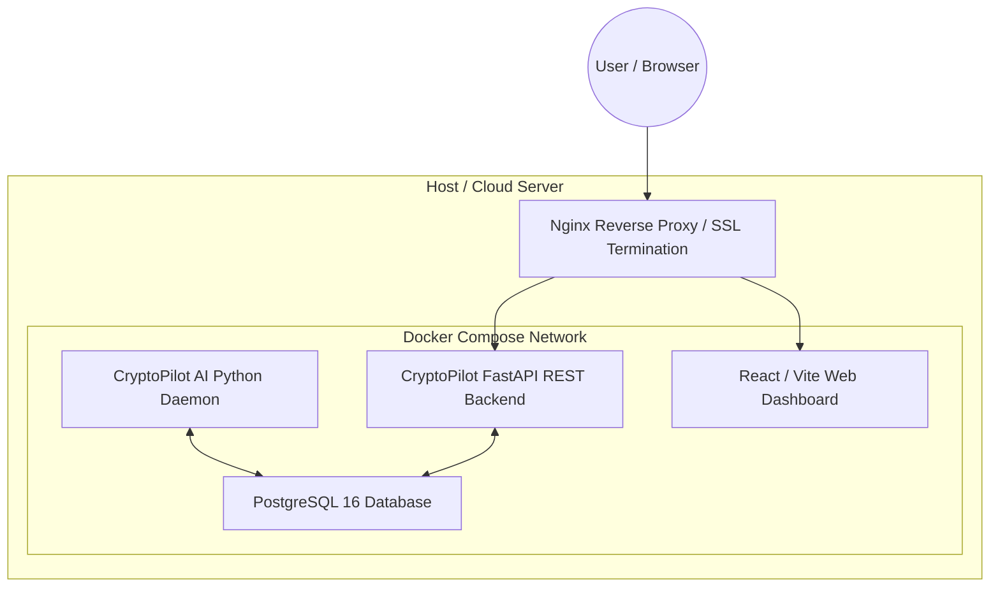

# CryptoPilot AI: Deployment & Operations Guide

## 1. Deployment Topology

CryptoPilot AI is designed for containerized deployment via **Docker** and **Docker Compose**, running as a self-contained service cluster with an isolated PostgreSQL database.



---

## 2. Docker Architecture

### 2.1 Multi-Stage Dockerfile (`Dockerfile`)
- **Stage 1 (Builder):** Installs Python build dependencies, compiles wheel packages, and sets up virtualenv.
- **Stage 2 (Runtime):** Lightweight, non-root user image containing only pinned production packages, application code, and security certificates.

### 2.2 Docker Compose Services
- `db`: Official `postgres:16-alpine` image with persistent volume mapping (`./data/postgres_data`).
- `backend`: FastAPI REST API and autonomous trading daemon.
- `dashboard`: Lightweight Nginx image serving built Vite/React static assets.

---

## 3. Deployment Checklist & Operational Procedures

### 3.1 Pre-Deployment
1. Generate `.env` from `.env.example` with secure random tokens.
2. Confirm `ENABLE_LIVE_TRADING=false` and `TRADING_MODE=paper`.
3. Verify database credentials and network isolation.

### 3.2 Database Migration Execution
Before starting the daemon, execute Alembic migrations:
```bash
docker compose run --rm backend alembic upgrade head
```

### 3.3 Starting Services
```bash
docker compose up -d --build
```

### 3.4 Operational Health Monitoring
- Query the health endpoint:
  ```bash
  curl -s http://localhost:8000/api/v1/health | jq .
  ```
- Inspect continuous logs:
  ```bash
  docker compose logs -f --tail=100 backend
  ```

---

## 4. Backup & Disaster Recovery

- **Database Dumps:** Automated daily `pg_dump` jobs backup portfolio ledgers, trade histories, and decision rationales.
- **State Recovery:** Since orders are strictly paper simulated, restarting the daemon cleanly restores state from the PostgreSQL database ledger.

