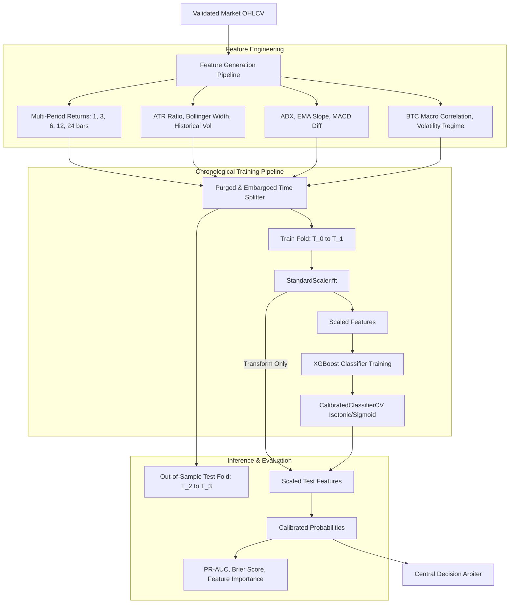

# CryptoPilot AI: Machine Learning Prediction Engine

## 1. Objective & Philosophy

The machine learning engine in CryptoPilot AI acts as a **probabilistic filter**, not an autonomous execution bot.
- An ML prediction is **never** a standalone trading signal and **never** submits orders directly.
- The model's sole mandate is to estimate the calibrated conditional probability that the forward asset return over a specified horizon $H$ exceeds round-trip transaction costs plus an edge margin:
  $$P\left(R_{t \to t+H} > \theta_{\text{fees+edge}} \mid \mathcal{F}_t \right)$$
- If data is noisy or the model is uncertain ($P \approx 0.50$), it exerts zero upward bias on trade generation.

---

## 2. Machine Learning Architecture

---

## 3. Target Formulation & Labeling

To avoid the noise of naive direction prediction, CryptoPilot AI defines a cost-adjusted binary target:

Let $P_t$ be the close price at bar $t$, and $H = 4$ bars (e.g. 4 hours on 1h candles).
$$\text{Forward Return: } R_{t, H} = \frac{P_{t+H} - P_t}{P_t}$$
$$\text{Cost Threshold: } \theta = 2 \times \text{TakerFee} + \text{Slippage} + \text{EdgeMargin} = 0.0020 + 0.0010 + 0.0020 = 0.50\%$$

$$\text{Target Label: } y_t = \begin{cases} 1 & \text{if } R_{t, H} > \theta \\ 0 & \text{otherwise} \end{cases}$$

---

## 4. Anti-Leakage Invariants

1. **Strict Chronological Splitting:** Random train/test shuffling is strictly prohibited.
2. **Purging & Embargoing:** Samples where the forward labeling horizon overlaps the test boundary are purged. An embargo period of 24 bars is applied after the training set to eliminate autocorrelation leakage.
3. **Out-of-Sample Preprocessing:** All scaling, clipping, and imputation transformations are fitted exclusively on the `train` partition and applied without refitting to `val` and `test`.
4. **Reproducibility:** All training scripts fix random seeds (`random_state=42`) and save detailed environment metadata alongside model artifacts.

---

## 5. Model Evaluation & Baselines

Models are evaluated not on accuracy (which is misleading for imbalanced financial data), but on:
- **Precision-Recall AUC (PR-AUC):** Evaluating positive predictive power for bullish breakouts.
- **Brier Score:** Measuring probability calibration accuracy.
- **Log-Loss:** Penalizing overconfident erroneous predictions.
- **Baseline Comparison:** Models must beat a naive majority-class classifier and a simple momentum heuristic baseline on out-of-sample data before being approved for decision arbitration.

