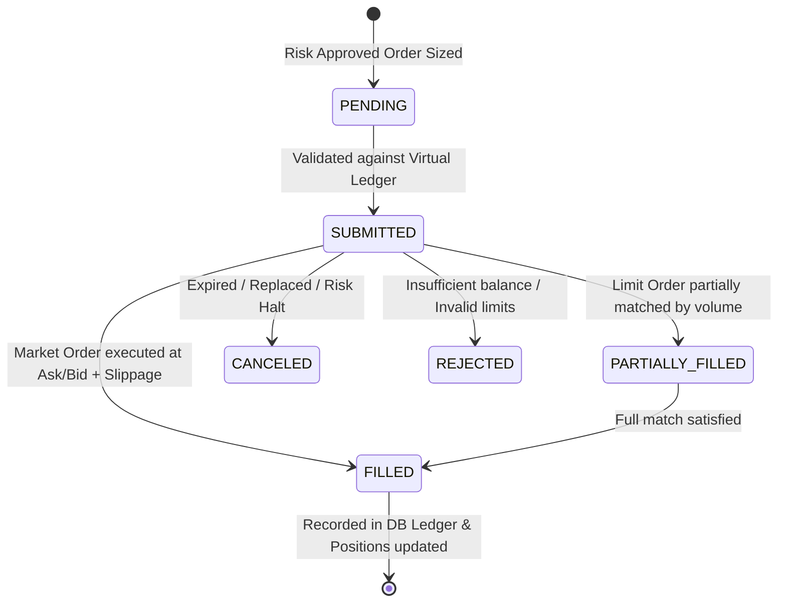

# CryptoPilot AI: Paper Trading & Virtual Execution Engine

## 1. Safety Mandate & Live Trading Prohibition

In this initial release, **CryptoPilot AI operates exclusively in PAPER TRADING mode**.
- Real-money exchange order routing is completely disabled at the architectural level.
- Public exchange connections (via CCXT) are utilized strictly for read-only market data ingestion (tickers, order books, OHLCV candles).
- No trading API keys with trade execution or fund withdrawal permissions are ever loaded or supported in this release.

---

## 2. Virtual Broker & Order Matching Simulation

The paper trading engine simulates a real exchange broker with sub-millisecond precision and explicit modeling of financial market frictions:

### 2.1 Order Types Supported
- **Simulated Market Order:** Fills immediately against the current public ticker:
  - BUY fills at: $P_{\text{fill}} = \text{Ask} \times (1 + \text{SlippageRate})$
  - SELL fills at: $P_{\text{fill}} = \text{Bid} \times (1 - \text{SlippageRate})$
- **Simulated Limit Order:** Placed on the virtual book and fills when public candle low/high crosses the limit price.
- **Simulated Bracket Order:** Combines a position entry with simultaneous virtual Stop-Loss and Take-Profit triggers monitored tick-by-tick.

### 2.2 Frictions & Cost Accounting
Every virtual trade automatically applies:
- **Taker Commission:** $0.10\%$ ($0.0010$) deducted from quote asset balance.
- **Maker Commission:** $0.05\%$ ($0.0005$) for non-immediate limit fills.
- **Spread Drag:** Explicitly models the bid-ask gap rather than executing on artificial mid-prices.

---

## 3. Account Ledger Isolation

The engine supports two completely isolated virtual environments:

| Feature | Small-Account Simulation | Research Simulation |
|---|---|---|
| **Account Identifier** | `small_account_01` | `research_lab_01` |
| **Initial Capital** | $30.00 | $10,000.00 |
| **Periodic Deposits** | $10.00 monthly deposit ledger | None (fixed capital pool) |
| **Max Allocation** | 30% of Equity ($9.00 initially) | 20% of Equity |
| **Max Concurrent Positions**| 1 position | Up to 3 positions |
| **Exchange Minimum Check** | Enforced strictly (skips trade if violated)| Enforced |

---

## 4. Virtual Ledger Integrity & Audit Trails

To guarantee financial correctness:
1. **Atomic Portfolio Updates:** Balance deductions, order creations, and position adjustments occur within an ACID database transaction.
2. **Double-Entry Discipline:** Virtual cash decreases only by the exact notional value plus fees of the filled asset.
3. **Immutable Trade History:** Every trade record includes timestamp (UTC), order ID, fill price, quantity, fee, slippage, and rationale.
