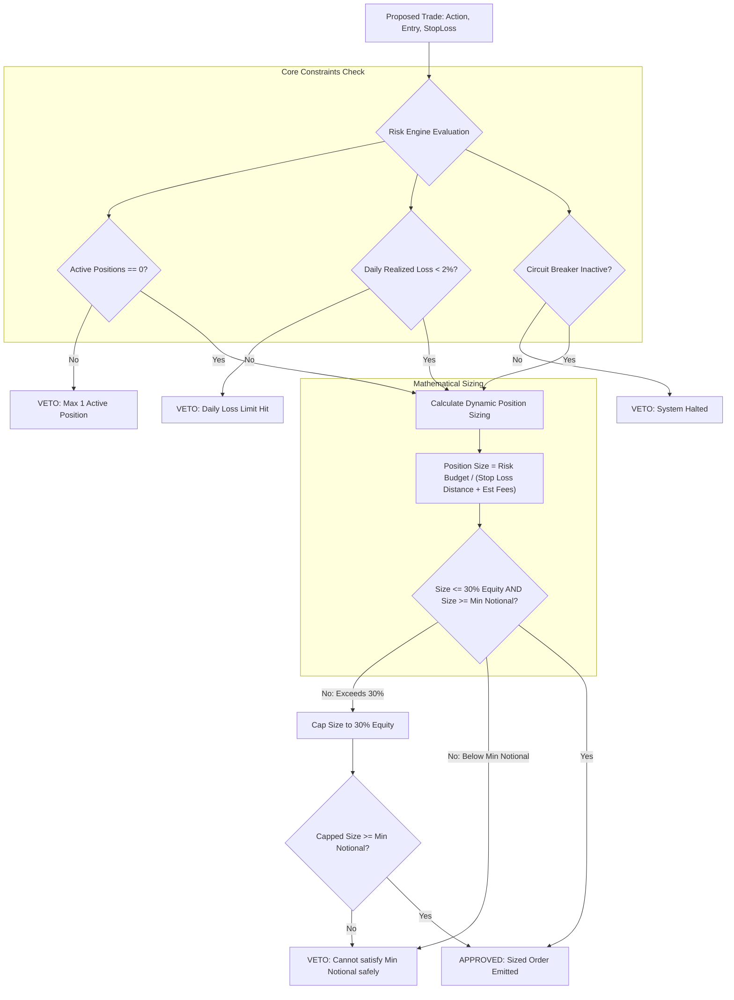

# CryptoPilot AI: Risk Management & Capital Allocation Framework

## 1. Quantitative Risk Mandate

Risk management is the supreme controlling authority within CryptoPilot AI. No strategy, machine learning model, or market indicator has the power to override risk limits.

---

## 2. Financial Parameters & Account Assumptions

| Parameter | Small-Account Rule | Research Lab Rule | Rationale |
|---|---|---|---|
| **Initial Capital** | $30.00 | $10,000.00 | Realistic micro-capital baseline vs statistical lab. |
| **Monthly Contribution**| $10.00 / month | Configurable | Capital injection ledgered separately from trading profits. |
| **Market Type** | Spot only | Spot only | Zero leverage; eliminates margin call/liquidation risk. |
| **Max Open Positions** | 1 position | 3 positions | Micro-capital cannot diversify without violating min notional. |
| **Max Allocation / Trade**| 30% of Equity | 20% of Equity | At $30 equity, max position is $9.00. |
| **Risk Budget / Trade** | 1.0% of Equity | 1.0% of Equity | At $30 equity, max dollar loss allowed is $0.30. |
| **Daily Loss Limit** | 2.0% of Daily Equity | 2.0% of Daily Equity| Circuit breaker halts trading for remainder of 24h cycle. |
| **Reinvestment Policy** | Automatic compounding| Automatic compounding| Profits increase subsequent equity; losses decrease size. |
| **Revenge Trading** | Strictly prohibited | Strictly prohibited | Never increase risk following consecutive losses. |

---

## 3. Position Sizing Mathematical Model

Position sizing is solved strictly from the maximum allowable financial risk per trade.

### 3.1 Mathematical Definitions
Let:
- $E$: Current total portfolio equity ($Cash + UnrealizedPnL$).
- $R_{pct}$: Risk percentage budget per trade ($1.0\% = 0.01$).
- $R_{\$}$: Dollar risk budget:
  $$R_{\$} = E \times R_{pct}$$
- $P_{entry}$: Estimated entry price.
- $P_{stop}$: Prescribed stop-loss price.
- $\Delta_{stop}$: Stop-loss price distance percentage:
  $$\Delta_{stop} = \frac{|P_{entry} - P_{stop}|}{P_{entry}}$$
- $C_{fee}$: Estimated round-trip trading cost percentage (e.g. $0.10\%$ taker fee entry $+ 0.10\%$ taker fee exit $= 0.20\% = 0.002$).
- $S_{notional}$: Target order notional value in quote currency ($USD$).

### 3.2 Target Sizing Formula
$$S_{notional} = \frac{R_{\$}}{\Delta_{stop} + C_{fee}} = \frac{E \times R_{pct}}{\frac{|P_{entry} - P_{stop}|}{P_{entry}} + C_{fee}}$$

### 3.3 Micro-Capital Constraint Enforcement
Once $S_{notional}$ is derived, it is subjected to four sequential boundary conditions:

1. **Max Allocation Boundary:**
   $$S_{notional} \le E \times 0.30$$
   *(If $S_{notional}$ exceeds 30% of portfolio equity, it is capped at $E \times 0.30$.)*

2. **Available Cash Boundary:**
   $$S_{notional} \le \text{Available Cash}$$

3. **Exchange Minimum Notional Boundary:**
   Let $M_{notional}$ be the exchange minimum notional (e.g. Binance requires minimum \$5.00 order size).
   - If $S_{notional} < M_{notional}$:
     - If capping or sizing results in a notional below exchange minimums, the system **rejects the trade entirely**.
     - **Crucial Rule:** The system will **never** artificially increase the position size to meet the minimum notional if doing so violates the 1% risk budget or 30% maximum allocation constraint!

4. **Precision Quantization:**
   $$Q = \text{floor}\left(\frac{S_{notional}}{P_{entry}}, \text{step\_size}\right)$$

---

## 4. Profit Compounding & Loss De-risking

- **Compounding on Wins:** When a trade closes profitably, realized gains enter `available_cash` and increase total equity $E$. The next trade's 1% risk budget is computed against the new, higher equity $E_{new} > E_{old}$.
- **Automatic De-risking on Losses:** When a trade loses, equity $E$ decreases. The next trade's 1% risk budget is strictly calculated against the lower equity $E_{new} < E_{old}$, automatically reducing position size and mitigating drawdown spirals.
- **Deposit Separation:** Monthly deposits ($10) increase equity and available cash, but are categorized in the database as `DEPOSIT_CAPITAL` rather than `TRADING_PNL`, ensuring accurate performance tracking (CAGR, Time-Weighted Return, Profit Factor).

---

## 5. Circuit Breakers & Emergency Protocols

1. **Daily Loss Limit (2%):**
   - At 00:00:00 UTC, the system snapshots starting equity $E_{start}$.
   - If accumulated realized loss + unrealized loss during that UTC day reaches $2.0\%$ of $E_{start}$, all trading is halted until the next UTC day.
2. **Consecutive Loss Cooldown:**
   - 3 consecutive losing trades trigger a mandatory 12-hour observation pause.
3. **Data Stale Circuit Breaker:**
   - If market data has not updated within 2 candle intervals, all new orders are blocked and existing open orders are canceled.
