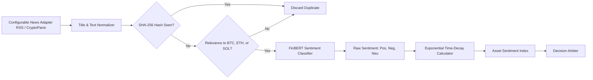

# CryptoPilot AI: Sentiment Analysis Engine

## 1. Sentiment Engine Principles

News and social headlines in cryptocurrency markets are notoriously noisy, frequently sensationalized, and often priced into market order books within seconds of publication.
CryptoPilot AI enforces five key sentiment rules:
1. **Never Invent News:** Under no circumstances does the system synthesize or extrapolate fictional news headlines.
2. **Aggressive Deduplication:** The same wire story published across multiple syndicates is processed exactly once using cryptographic hashing (SHA-256) of normalized titles.
3. **Strict Time Decay:** The predictive value of news decays exponentially. Headlines older than 6 hours receive near-zero weight; headlines older than 24 hours are discarded.
4. **Already-Priced-In Discounting:** The system assumes that high-sentiment news occurring during a large price pump has already been absorbed by market participants.
5. **Conservative Final Weight:** In the Central Decision Arbiter, sentiment has a minor supplementary weight ($< 15\%$) and **cannot** overturn bearish technical indicators or risk vetoes.

---

## 2. Ingestion & NLP Pipeline

---

## 3. Mathematical Models

### 3.1 FinBERT Sentiment Classification
FinBERT outputs softmax probabilities for three classes:
$$P(\text{Bullish}), \quad P(\text{Bearish}), \quad P(\text{Neutral})$$
$$\text{Polarity Score: } S = P(\text{Bullish}) - P(\text{Bearish}) \in [-1.0, 1.0]$$

### 3.2 Time-Decay Weighting
Let $t_{\text{current}}$ be the evaluation time, $t_{\text{pub}}$ be the article's UTC publication time, and $\lambda$ be the decay half-life ($t_{1/2} = 2 \text{ hours}$):
$$\Delta t = \max\left(0, t_{\text{current}} - t_{\text{pub}}\right)$$
$$w_{\text{time}}(\Delta t) = e^{-\frac{\ln(2)}{t_{1/2}} \times \Delta t}$$

If $\Delta t > 6 \text{ hours}$, $w_{\text{time}} < 0.125$. If $\Delta t > 24 \text{ hours}$, the article is purged.

### 3.3 Aggregated Symbol Sentiment Score
For a given symbol $S$ with $N$ active recent articles:
$$\text{SentimentIndex}(S) = \frac{\sum_{i=1}^{N} S_i \times w_{\text{time}, i} \times \text{Relevance}_i}{\sum_{i=1}^{N} w_{\text{time}, i} \times \text{Relevance}_i}$$

If no relevant news exists in the window, $\text{SentimentIndex}(S) = 0.0$ (Neutral).
