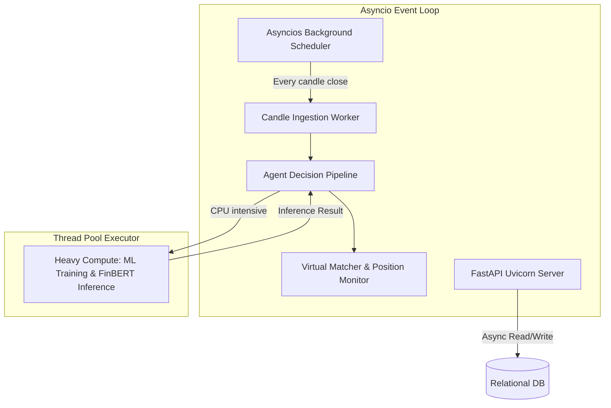
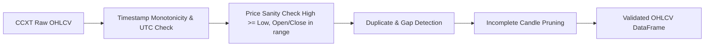

# CryptoPilot AI: Detailed System Design

## 1. System Design & Concurrency Model

CryptoPilot AI is designed to run as an autonomous, single-process, asynchronous daemon with an embedded FastAPI management and telemetry layer.



### 1.1 Concurrency Model
- **I/O Bound Operations:** Market data fetching (CCXT public REST), database queries (SQLAlchemy async sessions), news feed retrieval, and REST API requests run asynchronously on the main Python `asyncio` event loop.
- **CPU Bound Operations:** XGBoost model training, multi-year backtesting sweeps, and Transformer tokenization/inference are offloaded to a dedicated `concurrent.futures.ThreadPoolExecutor` or `ProcessPoolExecutor` to ensure that API responses and heartbeat timers are never blocked.

---

## 2. Core Component Interfaces

### 2.1 Market Data Ingestion Interface
```python
from abc import ABC, abstractmethod
from typing import List, Optional
from datetime import datetime
from pydantic import BaseModel

class Candle(BaseModel):
    symbol: str
    timeframe: str
    timestamp: datetime
    open: float
    high: float
    low: float
    close: float
    volume: float
    is_closed: bool

class IMarketDataProvider(ABC):
    @abstractmethod
    async def fetch_historical_ohlcv(
        self, symbol: str, timeframe: str, since: Optional[datetime] = None, limit: int = 500
    ) -> List[Candle]:
        """Fetch historical validated OHLCV candles."""
        pass

    @abstractmethod
    async def fetch_ticker(self, symbol: str) -> dict:
        """Fetch current bid, ask, and last price."""
        pass

    @abstractmethod
    async def fetch_order_book(self, symbol: str, limit: int = 20) -> dict:
        """Fetch top order book depth."""
        pass
```

### 2.2 Technical Indicator Interface
```python
from typing import Dict, Any
import pandas as pd

class IIndicatorCalculator(ABC):
    @abstractmethod
    def calculate(self, df: pd.DataFrame) -> pd.DataFrame:
        """
        Pure function: Computes indicator vectors on a validated OHLCV DataFrame.
        Guarantees zero-lookahead bias.
        """
        pass
```

### 2.3 Strategy Interface
```python
from enum import Enum
from pydantic import BaseModel

class SignalType(str, Enum):
    BUY = "BUY"
    SELL = "SELL"
    HOLD = "HOLD"

class StrategySignal(BaseModel):
    strategy_id: str
    symbol: str
    signal: SignalType
    confidence: float # Range: [0.0, 1.0]
    entry_price: float
    suggested_stop_loss: float
    suggested_take_profit: Optional[float]
    rationale: str
    timestamp: datetime

class ITradingStrategy(ABC):
    @abstractmethod
    def evaluate(self, df: pd.DataFrame, symbol: str) -> StrategySignal:
        """Evaluates indicators and returns a deterministic signal."""
        pass
```

### 2.4 Autonomous Decision Arbiter Interface
```python
class AgentDecision(BaseModel):
    decision_id: str
    symbol: str
    decision: SignalType
    composite_confidence: float
    strategy_signals: List[StrategySignal]
    ml_prediction: Dict[str, Any]
    sentiment_score: Dict[str, Any]
    market_regime: str
    risk_approved: bool
    rejection_reason: Optional[str]
    explanation: str
    timestamp: datetime

class IDecisionArbiter(ABC):
    @abstractmethod
    def synthesize_decision(
        self,
        symbol: str,
        strategy_signals: List[StrategySignal],
        ml_prediction: Optional[Dict[str, Any]],
        sentiment: Optional[Dict[str, Any]],
        market_regime: str
    ) -> AgentDecision:
        """Combines all input streams into a synthesized trading proposal."""
        pass
```

### 2.5 Risk & Capital Management Interface
```python
class SizedOrderProposal(BaseModel):
    symbol: str
    order_type: str # 'MARKET' or 'LIMIT'
    side: str # 'BUY' or 'SELL'
    quantity: float
    notional_value: float
    stop_loss_price: float
    take_profit_price: Optional[float]
    risk_percentage: float
    rationale: str

class IRiskManager(ABC):
    @abstractmethod
    def evaluate_and_size(
        self,
        decision: AgentDecision,
        current_equity: float,
        available_cash: float,
        open_positions: List[Any],
        daily_loss_amount: float
    ) -> Optional[SizedOrderProposal]:
        """
        Enforces 1% risk budget, 30% max allocation, 1 active position,
        and minimum exchange notional. Returns None if vetoed.
        """
        pass
```

---

## 3. Data Integrity & Validation Pipeline

Before any candle data reaches the indicator or strategy engines, it passes through a 4-stage data validation pipeline:



1. **Monotonicity & UTC:** Verifies timestamps strictly increment by `timeframe` delta with zero timezone ambiguity.
2. **Price Sanity:** Ensures $High \ge Low$, $High \ge \max(Open, Close)$, and $Low \le \min(Open, Close)$. Asserts $Volume \ge 0$.
3. **Gap Detection:** Detects missed candles. If gaps are found, the engine queries historical ranges to backfill. If backfill fails, the system logs a missing data warning and refuses to interpolate synthetic prices.
4. **Pruning:** Rejects the currently building candle to ensure signals only trigger on confirmed bar closes.

---

## 4. Failure States & Circuit Breakers

| Failure Condition | Immediate System Behavior | Recovery Action |
|---|---|---|
| **Public Exchange API Timeout (CCXT)** | Retry with exponential backoff (1s, 2s, 4s, 8s). Max 3 retries. Default to `HOLD`. | Resumes on subsequent candle cycle. |
| **Exchange Rate Limit (HTTP 429)** | Halt outbound requests for cooldown duration specified in `Retry-After` header. | Slows down request intervals. |
| **Missing Candles Detected** | Revert decision state to `HOLD`. Do not execute trades on incomplete series. | System backfills missing candles before next evaluation. |
| **ML Model Exception / NaN Output** | Log model inference failure. Neutralize ML component ($Weight = 0$). Arbiter evaluates remaining inputs or defaults to `HOLD`. | Alert raised in dashboard; uses purely technical fallback. |
| **Daily Loss Limit Hit ($\ge 2\%$)** | Close existing open position (if configured) or prevent any new opening orders. Trigger **TRADING_HALT**. | Trading halted until 00:00:00 UTC resets daily ledger. |
| **Exchange Minimum Notional Violation** | Reject order. Size cannot safely meet exchange minimum without violating 30% allocation cap. | Log risk veto reason: `MIN_NOTIONAL_VIOLATION`. |

