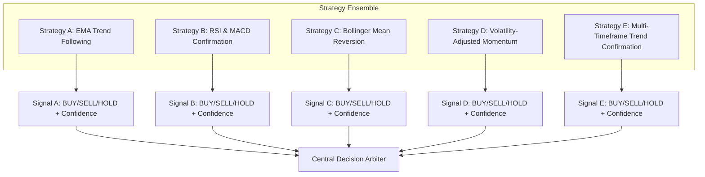

# CryptoPilot AI: Trading Strategy Engine

## 1. Quantitative Design Principles

1. **Rule-Based Determinism:** Each strategy is a pure, reproducible function that evaluates indicators on closed candles and produces a typed `StrategySignal`.
2. **Mandatory HOLD State:** Financial edge is rare. In the absence of a verified mathematical setup meeting all entry conditions, strategies must default to `HOLD`.
3. **No Naive Counter-Trend Buying:** An oversold RSI ($\le 30$) or a price touching the lower Bollinger Band does **not** generate a `BUY` signal by itself. Counter-trend momentum must be confirmed by momentum divergence or volume exhaustion to prevent "catching falling knives".
4. **Explicit Confidence Scoring:** Each signal returns a confidence score in the normalized range $[0.0, 1.0]$. A score below $0.50$ is treated as an unconfirmed signal.
5. **Pre-defined Risk Levels:** Every `BUY` or `SELL` signal must provide an objective `suggested_stop_loss` calculated using volatility (e.g. ATR multiples) or structural swing points.

---

## 2. Strategy Specifications

---

### 2.1 Strategy A: EMA Trend Following
Captures sustained directional trends by combining moving average crossovers with trend strength filters.

- **Indicators Used:** Fast EMA (e.g., 20), Slow EMA (e.g., 50), Baseline EMA (e.g., 200), ADX (14).
- **Entry Conditions (BUY):**
  1. Price $> EMA_{200}$ (macro bull regime).
  2. $EMA_{20}$ crosses above $EMA_{50}$.
  3. $ADX \ge 25$ (verifying strong trend, not choppy sideways consolidation).
  4. $ADX$ slope is positive over the last 3 bars.
- **Exit Conditions:**
  - $EMA_{20}$ crosses below $EMA_{50}$ OR price closes below $EMA_{50}$.
- **Stop-Loss Logic:**
  - Placed at $\min(\text{Swing Low of last 5 bars}, Close - 2.0 \times ATR_{14})$.
- **Invalidation Condition:**
  - If price closes below $EMA_{200}$ prior to stop-loss hit.
- **Confidence Formula:**
  $$\text{Confidence} = 0.50 + 0.25 \times \min\left(1.0, \frac{ADX - 25}{25}\right) + 0.25 \times \min\left(1.0, \frac{EMA_{20} - EMA_{50}}{ATR_{14}}\right)$$

---

### 2.2 Strategy B: RSI & MACD Confirmation
Captures high-probability momentum continuations by demanding synchronous confirmation across momentum and oscillator domains.

- **Indicators Used:** RSI (14), MACD Line, MACD Signal, MACD Histogram, EMA (50).
- **Entry Conditions (BUY):**
  1. Price $> EMA_{50}$.
  2. MACD histogram crosses from negative to positive ($Histogram_{t} > 0$ and $Histogram_{t-1} \le 0$).
  3. RSI is in the active bullish momentum zone ($50 < RSI < 70$). RSI must **not** be overbought ($RSI \ge 70$).
  4. Volume $> \text{SMA}_{20}(Volume)$.
- **Exit Conditions:**
  - MACD histogram turns negative for 2 consecutive bars OR $RSI > 75$ (overbought exhaustion).
- **Stop-Loss Logic:**
  - $Close - 1.5 \times ATR_{14}$.
- **Invalidation Condition:**
  - MACD Line drops below zero line ($MACD < 0$).
- **Confidence Formula:**
  $$\text{Confidence} = 0.50 + 0.25 \times \frac{70 - RSI}{20} + 0.25 \times \min\left(1.0, \frac{\text{Histogram}}{\text{Signal}}\right)$$

---

### 2.3 Strategy C: Bollinger Band Mean Reversion
Identifies extreme statistical price dislocations within consolidating or ranging markets.

- **Indicators Used:** Bollinger Bands (20 periods, 2.0 standard deviations), RSI (14), ADX (14).
- **Regime Filter:**
  - Strategy only active when $ADX < 20$ (strictly ranging market). In trending markets ($ADX \ge 20$), this strategy outputs `HOLD`.
- **Entry Conditions (BUY):**
  1. Low price touches or pierces Lower Band ($Low \le Band_{lower}$).
  2. Bullish candle close ($Close > Open$).
  3. Bullish RSI divergence or $RSI$ crosses back above $35$ after piercing below $30$.
- **Exit Conditions:**
  - Price touches Middle Band (SMA 20) for partial exit, or Upper Band for full exit.
- **Stop-Loss Logic:**
  - $Band_{lower} - 0.5 \times ATR_{14}$.
- **Invalidation Condition:**
  - Lower band expands sharply downward (band walking during breakdown).
- **Confidence Formula:**
  $$\text{Confidence} = 0.50 + 0.30 \times \left(1.0 - \frac{ADX}{20}\right) + 0.20 \times \min\left(1.0, \frac{Close - Band_{lower}}{Band_{middle} - Band_{lower}}\right)$$

---

### 2.4 Strategy D: Volatility-Adjusted Momentum
Adapts position aggressiveness dynamically based on real-time volatility contraction and expansion phases.

- **Indicators Used:** Keltner Channels (20, 1.5 ATR), Bollinger Bands (20, 2.0 std), Chaikin Volatility, ATR (14).
- **Entry Conditions (BUY):**
  1. **Squeeze Release:** Bollinger Bands transition from inside Keltner Channels (volatility squeeze) to expanding outside Keltner Channels.
  2. Momentum oscillator (e.g. 12-period return) is positive.
  3. Close $> EMA_{20}$.
- **Exit Conditions:**
  - Volatility contraction starts OR Close $< EMA_{20}$.
- **Stop-Loss Logic:**
  - Trailing stop set at $Close - 2.5 \times ATR_{14}$.
- **Invalidation Condition:**
  - Immediate reversal closing below pre-squeeze consolidation midpoint.
- **Confidence Formula:**
  $$\text{Confidence} = 0.60 + 0.40 \times \min\left(1.0, \frac{Band_{width} - Band_{width, min}}{Band_{width, min}}\right)$$

---

### 2.5 Strategy E: Multi-Timeframe Trend Confirmation
Enforces hierarchical alignment across higher (1h) and lower (15m) timeframes to eliminate low-timeframe noise.

- **Timeframes:** Macro ($1h$), Micro ($15m$).
- **Entry Conditions (BUY):**
  1. **Macro Filter (1h):** Price $> EMA_{50}(1h)$ and $MACD_{1h} > 0$.
  2. **Micro Pullback (15m):** On $15m$, price pulls back towards $EMA_{20}(15m)$ with $RSI_{15m}$ dipping into $[40, 50]$.
  3. **Micro Resumption (15m):** Bullish reversal candle forms on $15m$ with $Close > Open$ and volume above average.
- **Exit Conditions:**
  - $1h$ trend reverses (price crosses below $EMA_{50}(1h)$) OR $15m$ stop-loss is reached.
- **Stop-Loss Logic:**
  - Recent swing low on $15m$ timeframe minus $0.5 \times ATR_{15m}$.
- **Confidence Formula:**
  $$\text{Confidence} = 0.70 + 0.15 \times \text{MacroStrength} + 0.15 \times \text{VolumeConfirmation}$$

---

## 3. Signal Aggregation & Conflict Resolution

When individual strategies generate conflicting signals (e.g. Strategy A BUY vs Strategy C SELL):
1. The **Market Regime Classifier** determines which strategy class has precedence (e.g., trend-following dominates during $ADX > 25$; mean-reversion dominates during $ADX < 20$).
2. If disagreement persists with high confidence on both sides, the decision engine defaults to **HOLD**.

